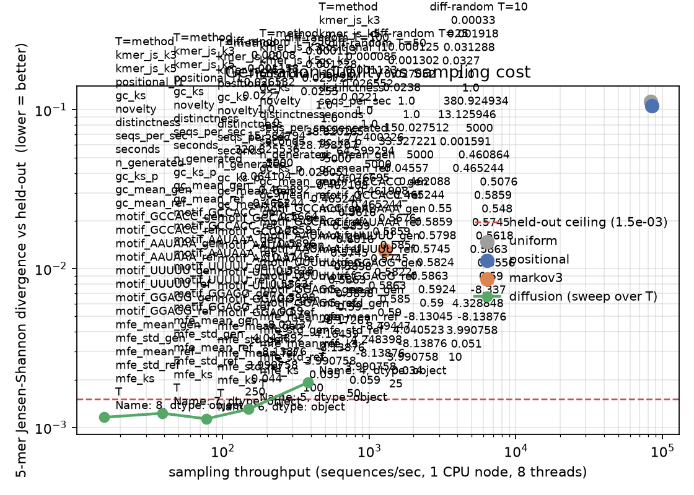
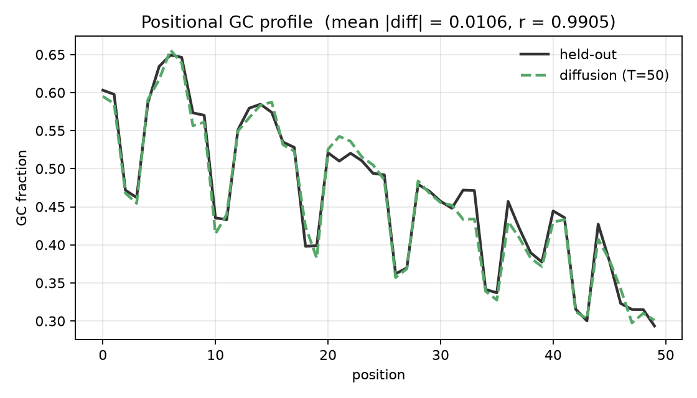
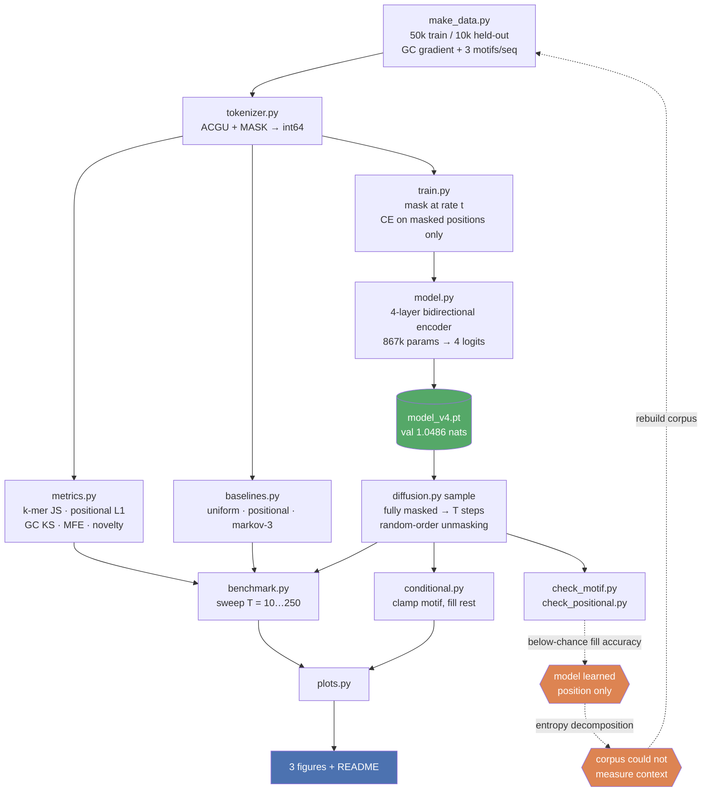
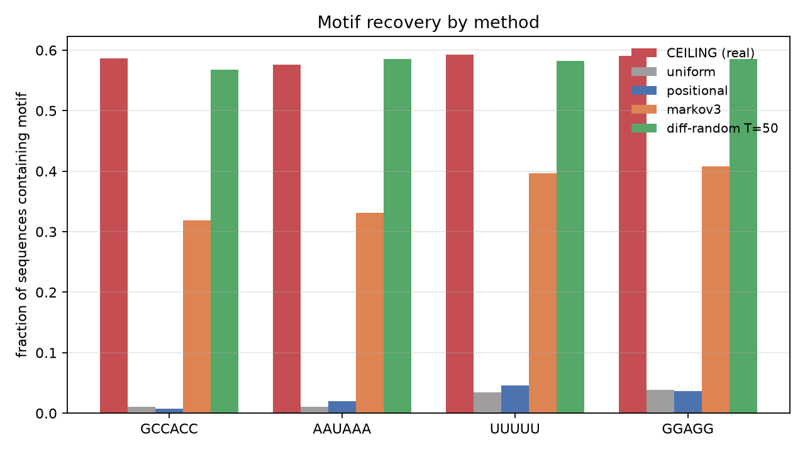

# Discrete Diffusion for Conditional RNA Sequence Generation

A masked (absorbing-state) discrete diffusion model that generates fixed-length
RNA sequences, supports conditional partial generation with held-fixed motifs,
and is benchmarked against non-neural baselines on both sequence quality and
sampling throughput.

**Result.** The diffusion model is the only method tested that reproduces
positional composition and local motif structure *simultaneously*. It reaches
5-mer Jensen-Shannon divergence of 1.13e-03 against a held-out estimate of
1.50e-03 — 12× better than an order-3 Markov chain — while matching a
positional-frequency baseline on positional L1, at a cost of roughly 1000×
lower sampling throughput. Quality saturates at about 50 sampling steps.



---

## Why discrete diffusion

Gaussian diffusion does not transfer to nucleotide sequences. Adding Gaussian
noise to a token id is meaningless — there is no sense in which G lies between
A and U. Discrete diffusion instead defines corruption as a Markov chain over
the token alphabet.

This project uses the **absorbing-state** variant: the forward process replaces
nucleotides with a `[MASK]` token and never moves them back. Two properties
follow, and both matter practically:

- `q(x_t | x_0)` is available in closed form — each position is masked
  independently with probability `t` — so training requires no sequential
  simulation of the noising chain.
- The reverse process reduces to masked-token prediction, which a standard
  bidirectional transformer encoder solves directly.

The denoiser is bidirectional rather than causal. A causal mask would make this
an autoregressive model, which is a different method: the point of the
diffusion formulation is that positions are filled in parallel over a
controllable number of steps, and that number is the quality/cost knob the
benchmark sweeps.

## Method

**Forward.** At noise level `t ~ U(0, 1]`, mask each position independently
with probability `t`.

**Model.** Bidirectional transformer encoder, 4 layers, `d_model=128`, 4 heads,
866,820 parameters. Learned positional embeddings; sinusoidal timestep
embedding added to every token.

The output head has 4 logits, not 5: `[MASK]` is an input state the model must
recognise, never a target it should predict. Giving the head a MASK logit lets
the model lower its loss by predicting MASK back.

**Training.** Cross-entropy at masked positions only. The ELBO weighting
(`1/t`) was implemented first and removed — with `t ~ U[0.001, 1]` the weights
reach 1000×, so rare small-`t` draws dominate the gradient. Training loss
oscillated (11.5 → 16.5 → 9.4 over three epochs) and sampling collapsed to a
single repeated base. The unweighted objective is stable and is what the
reported results use.

12 epochs, AdamW, OneCycle schedule to `lr=1e-3`, batch 256, ~48 s/epoch on one
CPU node.

**Sampling.** Start fully masked. At each of `T` steps, predict all masked
positions, commit a subset, re-mask the rest. The number left masked follows a
cosine schedule reaching zero at the final step.

**Conditional generation.** Positions marked fixed are clamped to supplied
values and never re-masked, so a motif is held constant while the model fills
surrounding context conditioned on it.

## Data

Synthetic, generated by `src/make_data.py`: 50,000 training and 10,000 held-out
sequences of length 50 over `{A, C, G, U}`, carrying two orthogonal signals:

1. A positional GC gradient, 0.70 at the 5' end falling to 0.30 at the 3' end.
2. Three motifs per sequence drawn from `{GCCACC, AAUAAA, UUUUU, GGAGG}`,
   placed in spaced slots, covering roughly a third of all positions.

Position and local context are deliberately separate axes. No single non-neural
baseline captures both, which is what makes the comparison informative.

**Entropy reference points** (nats/token, natural log), measured empirically on
the corpus:

| | value |
|---|---|
| uniform over 4 bases | 1.3863 |
| positional marginals only | 1.3445 |
| order-6 Markov, context only | 1.2110 |
| **trained model (held-out)** | **1.0486** |

These bound what any model can achieve and make the training loss
interpretable. The model is 0.16 nats below the best pure-context baseline, so
it is combining both signals rather than fitting either alone.

## Benchmark

5,000 generated sequences per method, evaluated against the 10,000-sequence
held-out set. Single CPU node (Northeastern Explorer), 8 threads, no GPU.

| method | k=3 JS | k=5 JS | pos. L1 | seq/s |
|---|---|---|---|---|
| held-out estimate | 9.14e-05 | 1.50e-03 | 0.0275 | — |
| uniform | 4.25e-02 | 1.12e-01 | 0.2248 | 83,076 |
| positional | 3.83e-02 | 1.06e-01 | 0.0258 | 84,562 |
| order-3 Markov | 2.35e-04 | 1.32e-02 | 0.1989 | 1,279 |
| diffusion T=10 | 3.30e-04 | 1.92e-03 | 0.0313 | 381 |
| diffusion T=25 | 1.25e-04 | 1.30e-03 | 0.0271 | 150 |
| **diffusion T=50** | **8.49e-05** | **1.13e-03** | **0.0266** | **77** |
| diffusion T=100 | 1.13e-04 | 1.23e-03 | 0.0297 | 39 |
| diffusion T=250 | 8.01e-05 | 1.16e-03 | 0.0265 | 16 |

The baselines fail on complementary axes. The positional baseline has excellent
positional L1 (0.0258) but 5-mer divergence of 1.06e-01, barely better than
uniform random. The order-3 Markov chain recovers k-mer statistics (1.32e-02)
but has positional L1 of 0.1989, close to uniform. Only the diffusion model is
good on both at once.

**Caveat on the ceiling.** At T=50 and T=250 the model scores *below* the
held-out estimate. A generator cannot genuinely beat real data at matching real
data; the ceiling is estimated from 5,000 held-out sequences against the full
set and carries its own sampling noise. The correct reading is that the model
is at the ceiling, not past it.

**Sampling cost.** Dropping from T=50 to T=10 gives a 5× speedup for 1.7×
worse divergence. Above T=50 there is no measurable gain: a three-seed check
gave 4.45e-03 ± 3.1e-04 at T=50 and 4.52e-03 ± 3.9e-04 at T=100, overlapping
within one standard deviation, so the apparent T=100 regression in the table is
noise. T=250 costs 5× T=50 and buys nothing.

All timings are wall-clock on an idle node. Benchmark runs were serialised —
concurrent jobs on a shared node distort throughput, and an early contaminated
run was discarded. Relative comparisons transfer across hardware; absolute
throughput does not.



## Conditional generation

Each motif was clamped at three positions, 1,000 sequences per configuration.
Retention was 1.000 everywhere, confirming the clamping logic. Quality metrics
are computed on the **non-fixed positions only**, since including supplied
positions would flatter the result.

| constraint position | mean k=3 JS (free) | mean pos. L1 (free) |
|---|---|---|
| 5 | 4.26e-03 | 0.145 |
| 22 | 2.07e-03 | 0.076 |
| 40 | 1.28e-03 | 0.063 |

Constraints near the 5' end degrade surrounding context more. The worst case is
`UUUUU` at position 5 (8.36e-03, ~7× the best): the corpus places motifs in
slots at multiples of 8, so position 5 is off-grid, and the GC gradient starts
at 0.70 there, making an AU-rich motif doubly out of distribution. The model
honours the constraint but surrounding composition shifts to accommodate it.



## Findings

### 1. Confidence-based decoding biases the output distribution

MaskGIT-style sampling commits the highest-confidence positions at each step.
That heuristic systematically selects positions where the sampled token
happened to be the likely one, and the bias compounds over `T` steps toward the
per-position mode.

Measured at T=50, n=1000:

| unmasking order | mean GC diff | corr | k=3 JS | k=5 JS |
|---|---|---|---|---|
| confidence | 0.293 | 0.889 | 2.8e-01 | 4.6e-01 |
| confidence + annealed Gumbel | 0.098 | 0.988 | 1.4e-02 | 3.6e-02 |
| **random** | **0.013** | **0.997** | **2.6e-03** | **1.4e-02** |

Confidence-based decoding scored 14× *worse than uniform random sequence* on
k=3 divergence while producing individually plausible-looking sequences.
Per-sample plausibility and distributional fidelity are different objectives.

Random-order unmasking is also the theoretically correct choice: the forward
process masks positions independently of content, so the reverse must unmask
them the same way. It is the default; `order="confidence"` is retained for
comparison.

### 2. A k=3 metric is degenerate against an order-3 Markov baseline

On an earlier corpus the order-3 Markov baseline scored 7.5e-05 on k=3
divergence against a ceiling of 7.4e-05 — an apparently perfect result. It is
an artifact: a Markov-3 chain is *fit on* 3-mer statistics, so grading it with
3-mer divergence scores it on its own training objective. At k=5 the gap
reappears. All k-mer results are reported at both k=3 and k=5.

### 3. Below-chance motif infilling diagnoses what a model has learned

`src/check_motif.py` masks one position inside an otherwise fully visible motif
and asks the model to fill it. Chance is 0.25.

| motif | first corpus | final corpus |
|---|---|---|
| GCCACC | 0.176 | **0.998** |
| AAUAAA | 0.497 | **0.994** |
| UUUUU | **0.063** | **0.977** |
| GGAGG | 0.563 | **0.975** |

Two motifs originally scored *below chance*. That can only happen if the model
predicts the positional prior and the motif contradicts it: `UUUUU` landing in
a GC-rich region draws a confident, wrong G/C prediction nearly every time. The
two above-chance motifs were exactly those whose composition agreed with where
they sat. The model had learned positional marginals and no contextual
dependency at all.

### 4. The first corpus could not measure the capability under test

The diagnosis above initially looked like a model bug. It was not. Measuring
the entropy decomposition of that corpus:

| | first corpus | final corpus |
|---|---|---|
| positional marginals | 1.2909 | 1.3445 |
| order-6 Markov (context only) | 1.3236 | 1.2110 |

On the first corpus, *pure context models did worse than position alone*.
Motifs appeared in 65% of sequences at random positions, so only ~7% of
positions sat inside one, worth at most ~0.07 nats. Three training runs
converged to 1.2919, essentially exactly the positional floor of 1.2909 — the
model had captured the dominant signal and correctly ignored a negligible one.

The corpus was rebuilt with three motifs per sequence in spaced slots (~33% of
positions) and a gentler gradient. Context is now worth 0.13 nats beyond
position, and the test is sharp: any model below 1.3445 is provably using
context. The final model reaches 1.0486.

An earlier analytical floor of 1.2787 quoted during development was also wrong:
it was computed from the GC gradient alone and ignored that motif implantation
overwrites gradient-sampled bases, flattening positional composition. The
empirical 1.2909 is correct.



## Limitations

- **Synthetic data.** Conclusions about relative method performance transfer;
  conclusions about RNA biology do not.
- **MFE does not discriminate on this corpus.** Held-out vs held-out gives a KS
  statistic of 0.05; uniform random vs held-out gives 0.04. Random 50-mers fold
  about as well as structured ones, because MFE at this length is driven by
  chance complementarity rather than composition. Reported for completeness;
  not evidence of anything.
- **CPU only.** Model size and training length were chosen to fit a CPU node.
- **Fixed length.** Variable-length generation would need padding and a length
  model.
- **One seed per benchmark configuration**, except the T=50/T=100 comparison.

## Further work

- Classifier-free guidance toward GC or MFE targets.
- Flow matching on the simplex as a comparison method.
- Real 5' UTR data (e.g. the Sample et al. 2019 MPRA library) with ribosome
  load as a conditioning signal.
- Variable-length generation.

## Repository layout

```
src/
  tokenizer.py         ACGU + [MASK] vocabulary, encode/decode
  make_data.py         synthetic corpus generation
  metrics.py           k-mer JS, GC KS, positional L1, MFE, novelty
  baselines.py         uniform, positional, order-n Markov
  model.py             transformer denoiser
  diffusion.py         forward process, loss, sampler
  train.py             training loop
  benchmark.py         quality vs speed sweep
  conditional.py       constrained generation with fixed motifs
  check_positional.py  sampler sanity check
  check_motif.py       motif infilling diagnostic
  plots.py             figures
```

## Reproducing

```bash
conda create -p ./envs/rnadiff python=3.11 -y
source activate ./envs/rnadiff
pip install torch numpy pandas matplotlib scipy tqdm ViennaRNA

python src/make_data.py
python src/train.py --epochs 12 --lr 1e-3 --dropout 0.0 --out results/model_v4.pt
python src/benchmark.py --n 5000 --model results/model_v4.pt
python src/conditional.py --model results/model_v4.pt
python src/plots.py --model results/model_v4.pt
```
